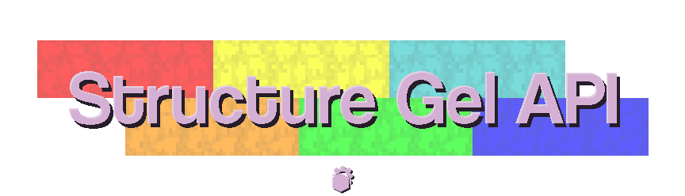

<h1 align="center">

</h1>

## About

This library mod seeks to make handling world gen easier on developers. Its main features include:

- Gel blocks that can be used to automatically fill a structure and replace with air using structure processors
- Jigsaw registry shortcuts/builders
- Data structure block handling within jigsaw structures
- Configurable structure classes
  - Placement separation values, mob spawns, data marker handling, etc
- Dimension registry events
- Extensible vanilla-like portal behavior
- An extended biome dictionary with support for many popular biome mods
- Registrars for holding registry data for dimensions and everything structure related
- Registry utilities for structures, structure processors, points of interest, and configured features

The code has been split into two packages: `com.legacy.structure_gel.core` and `com.legacy.structure_gel.api`. Anything in the api package is for developers to use, and will stay stable between updates. Anything in the core package or with the `@Internal` annotation is intended for internal use, and may have breaking changes at any time.

## Compatibility

The biome dictionary used in Structure Gel will automatically register biomes that haven't already been registered by using properties from biome. IE: Biomes with jungle in their name will be added to the jungle tag while biomes with snow get added to the snowy tag. This can be disabled in the config file.

## Installing in Your Workspace

Structure Gel can be downloaded from the Modding Legacy maven repository via the buildscript. To do so, follow these steps:

1. In the `build.gradle` file for your mod, add the Modding Legacy maven repository to the `repositories` block (it is not in the `buildscript` block)

```groovy
repositories {
    // ...

    maven {
        name "Modding Legacy Maven"
        url "https://maven.moddinglegacy.com/maven"
    }
}
```

2. In the `build.gradle` file for your mod, add Structure Gel API as a dependency.

```groovy
dependencies {
    // ...

    implementation fg.deobf("com.legacy:structure-gel:1.19.2-2.6.1")
}
```

To view a list of all the available versions, go to [our maven](https://maven.moddinglegacy.com/artifactory/modding-legacy/com/legacy/structure-gel/) to browse the files.

3. If your project is **not** using Mixin (or using MixinGradle), you will need to manually ask Mixin to respect the development environment's mappings. To do so, add `all` to your `runs` so that Mixins use the proper remapped names. Using the `all` run will automatically put it in all other run types.

```groovy
minecraft {
    runs {
        // ...

        all {
            def srgToMcpFile = project.tasks.createSrgToMcp.outputs.files[0].path

            property 'net.minecraftforge.gradle.GradleStart.srg.srg-mcp', srgToMcpFile
            property 'mixin.env.remapRefMap', 'true'
            property 'mixin.env.refMapRemappingFile', srgToMcpFile
        }
        
        // ...
    }
}
```

4. Add Structure Gel as a dependency for your mod in its `mods.toml` file.

```toml
[[dependencies.examplemod]]
    modId="structure_gel"
    mandatory=true
    versionRange="[2.6.1,)"
    ordering="NONE"
    side="BOTH"
```

5. Setup your workspace with the appropriate gradlew commands for your IDE.
    - For Eclipse
        - ``gradlew eclispe``
        - ``gradlew genEclipseRuns``
    - For IntelliJ
        - ``gradlew genIntellijRuns``

6. From here, assuming you see Structure Gel in your project's external dependencies, you should be able to use the API. If you do not see it, try refreshing your project as some IDEs won't do that automatically.
